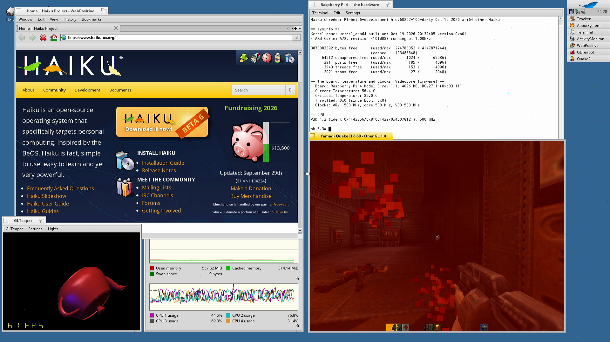
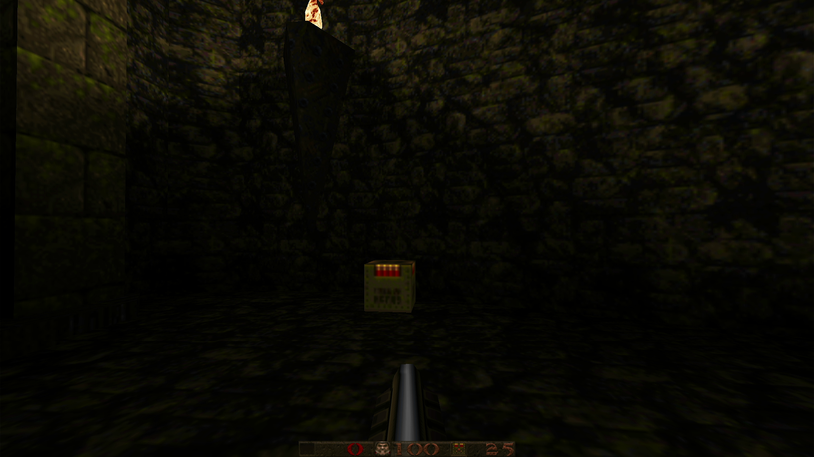
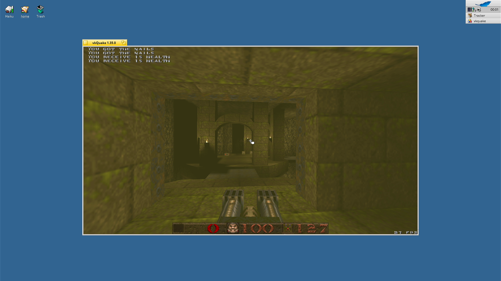
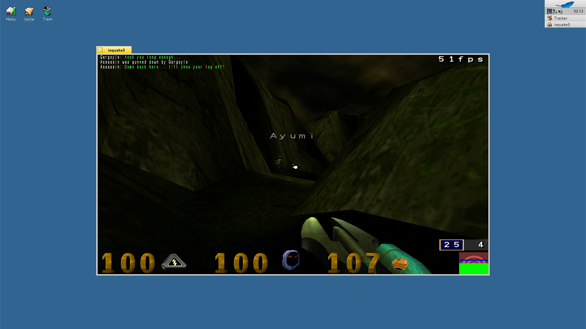
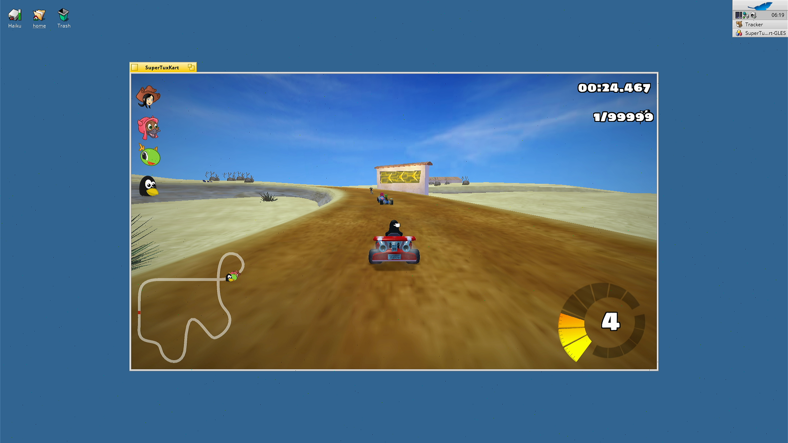

# Haiku on the Raspberry Pi 4 — a port built autonomously by an AI agent

> **Showcase, 2026-10-21** (measurements to the evening of 2026-10-20). The code in this project — the Pi drivers, the kernel fixes, the GPU and
> video stack, the arm64 packages, the build and test scripts — was written by an AI coding agent
> (Claude), working autonomously from a single starting prompt. The project's owner set the goal and
> the direction in a handful of prompts and owns the hardware; they did not write code.

## What it is

A port of [Haiku](https://www.haiku-os.org/), the open-source desktop operating system in the
tradition of BeOS, to the **Raspberry Pi 4 Model B (BCM2711, four Cortex-A72 cores, arm64)**. Upstream
Haiku's arm64 port ran on QEMU; it had no support for the Pi. Three days after the first prompt the
Pi boots the regular Haiku desktop from its SD card or from the network and runs:

- the Haiku desktop on HDMI with its applications, preferences and media kit;
- **OpenGL, OpenGL ES 3.1 and Vulkan 1.3** on the V3D GPU through Mesa;
- five 3D games, **WebPositive**, NetSurf and **Firefox 157**;
- hardware **HEVC** video decoding, Python 3.14, and `pkgman` with a public arm64 package repository.

The Haiku sources are in the fork [haiku-pi/haiku](https://github.com/haiku-pi/haiku), branch `rpi4`;
this repository holds the scripts, bench tools and documentation.

## Highlights

All numbers were measured on the bench Pi (4 GB) on 2026-10-18 to 2026-10-20; the
[weekly logs](docs/log/) record each one with its test.

- **First desktop on the real Pi 2 h 35 min after the first prompt** (2026-10-17 23:25 → 10-18 02:00
  CEST): SD card → U-Boot → Haiku loader → kernel on 4 CPUs → Tracker on HDMI at 1920×1080.
- **Boot:** desktop in about 80 s from the SD card, about 60 s over the network (the boot volume served
  by the build host as a remote disk; no SD card writing). Regular-image boot bench **10/10**.
- **Ethernet:** a new GENET driver, TCP **~915 Mbit/s each way** (from 623 up / 250 down on day one).
- **WiFi:** the BCM43455 over SDIO with OpenBSD's `bwfm` driver: WPA2, DHCP, **37 Mbit/s up / 46 down**.
- **Storage:** SD card at UHS-I DDR50, **43 MB/s** reads (from 10.5 MB/s at default speed); USB 3 storage
  through the PCIe-attached VL805 at **78–90 MB/s**.
- **GPU:** an in-kernel V3D driver with Linux's `v3d` interface, Mesa 26.2: windowed OpenGL ran 5 minutes
  at **485.6 fps, 0 GPU resets**; a zero-copy present path made an 800×800 GL window **3.8× faster**
  (39.9 → 151.8 fps).
- **Display:** a driver on the firmware's planes: **60.00 Hz retrace**, scaled display modes, a hardware
  cursor.
- **Games:** QuakeSpasm **56–70 fps** at 1280×720, Yamagi Quake II **81–89 fps** at 1280×720, **vkQuake
  52 fps** on Vulkan, OpenArena (ioquake3) **46 fps**, SuperTuxKart 1.5 **28–38 fps** (16–18 fps with its
  OpenGL ES shader renderer).
- **Video:** HEVC on the BCM2711's decoder block, **bit-exact**: 1080p at **114.8 fps** on under half a
  core (software: 25.5 fps on all four), 4K at 38.2 fps. MediaPlayer and Firefox use it with no change
  of their own.
- **Web:** WebPositive (HaikuWebKit 1.10, JavaScript JIT on) and NetSurf render
  https://www.haiku-os.org/ over HTTPS; **Firefox 157** renders it in 8–10 s once warm, with **WebGL 1
  and 2** on the GPU and H.264, VP9, AV1 and HEVC video.
- **Stability:** a 15-minute soak of Firefox + SuperTuxKart + 1080p HEVC at once: **0 crashes**; a
  20-minute load soak (Quake, SD write/verify, pings): 0 errors, 72 °C, clocks held.
- **Packages:** 88 arm64 packages built from HaikuPorts recipes and published (10-20) at
  [haiku-pi.github.io/packages](https://github.com/haiku-pi/packages); `pkgman` uses them out of the box.
- **Also:** Bluetooth through Haiku's stack (patch RAM 323/323 records, inquiry), audio on the 3.5 mm
  jack (44117.657 Hz measured, 0 underruns), CPU frequency scaling 600–1500 MHz, SoC temperature, GPIO,
  the hardware random number generator, CPython 3.14, Rust 1.90 for arm64 Haiku, llama2.c at 45.7
  tokens/s.

## Screenshots

Grabbed from the Pi's HDMI output by a capture card (1920×1080, unedited), 2026-10-20. More in
[docs/screenshots/](docs/screenshots/).


*WebPositive on haiku-os.org, GLTeapot on the V3D, ActivityMonitor with four cores, About Haiku
("4 Processors: ARM Cortex-A72 @ 1.50 GHz") and a Terminal showing the board as the VideoCore firmware
reports it: "Raspberry Pi 4 Model B rev 1.1, 4096 MB, BCM2711".*


*Yamagi Quake II (OpenGL on the V3D) playing its demo in a window; ActivityMonitor shows the four cores
at work.*


*QuakeSpasm full screen at 1920×1080 (30–42 fps).*


*vkQuake 1.35 on Vulkan (Mesa's V3DV, a Haiku WSI, SDL2) in a 1280×720 window. This frame is from the
first run at ~29 fps; V3D-friendly defaults later took it to 52 fps.*


*MediaPlayer playing a 1080p HEVC stream (20 Mbit/s) decoded by the BCM2711's HEVC block.*


*OpenArena 0.8.8 on ioquake3 (the Quake III engine) in a 1280×720 window: 46 fps in its timedemo.*


*SuperTuxKart with its OpenGL ES 3.1 shader renderer (lit, sky), 16–18 fps at 1280×720 — Haiku's GL
view now creates OpenGL ES contexts.*


*Firefox 157 on the Pi rendering https://www.haiku-os.org/ (its own `--screenshot` of the page).*

The others: [the Quake II desktop from another angle](docs/screenshots/03-desktop-quake2-b.png),
[WebPositive](docs/screenshots/05-webpositive.png), [SuperTuxKart's OpenGL 2.1
renderer](docs/screenshots/09-supertuxkart.png), [Firefox in a window](docs/screenshots/10-firefox-window.png).

## One hard bug: the freeze that was a livelock

Less than an hour after the first desktop, about half of all boots stopped silently. Everything the
agent could see pointed at the interrupt controller: a CPU sat idle with its timer interrupt pending,
the SD controller's interrupt shown "active" on it, and the boot resumed whenever another CPU touched
the GIC. A watchdog that nudged such a CPU made boots reliable (10/10), but a 20-minute soak under load
showed the stall every two minutes. Two rounds of rewriting the GIC setup to match Linux's changed
nothing. The answer came from the stalled CPU's *own* registers: its timer had fired on time, and
**interrupts were masked**. It was not deaf; it was spinning. Two CPUs were spinning on the same cache
line inside the kernel's condition variables, and on the Cortex-A72, which has no LSE atomics, one
CPU's tight polling kept breaking the other's load/store-exclusive loop. The fix, as in Linux: wait in
`WFE` with the generic timer's event stream as a bound. The watchdog was deleted; boots 10/10 and a
20-minute soak clean without it. From the first freeze to the root cause took 43 hours, including two
claims that it was solved that the agent itself later withdrew. The full story is in the
[field report](docs/AI-DRIVEN-PORT-JOURNEY.md).

## Build and run

- **[docs/TRY-IT.md](docs/TRY-IT.md)** — what works, with the numbers; build the image, flash a card, or
  boot it from the network.
- **[docs/BUILD.md](docs/BUILD.md)** — building the image. The from-scratch build was verified in a
  fresh clone: about 28 minutes on a 16-thread host, plus about an hour since WebKit joined.
- **[docs/USER-GUIDE.md](docs/USER-GUIDE.md)** — using Haiku on the Pi.

In short, on an x86-64 Linux host:

```sh
scripts/bootstrap.sh                       # sources, Haiku's arm64 cross tools, packages, firmware
scripts/build-uboot.sh
scripts/build.sh @minimum-mmc
scripts/build-packages.sh --sysroot
scripts/build.sh -sHAIKU_PI_GL=1 @pi-mmc   # → artifacts/images/haiku-pi4-regular.img
scripts/pi-test.sh --regular               # on a bench like ours: flash, boot, serial + HDMI capture
```

## Honest status

This is a three-day-old port, not a release. It runs on one bench Pi 4 (4 GB). Open:

- **Network boots of a Pi that was off for minutes** stop about once in 10, around 52 s in, with the whole
  machine silent; a warm Pi almost never does (about 1 in 250), and cold SD boots ran 12 of 12 clean.
- **Not checked by a person:** typing and pointing with the USB keyboard and mouse (they enumerate),
  sound from the headphone jack (the clock is measured), Bluetooth pairing, and whether faint
  off-colour pixels in the HDMI capture during GL rendering appear on a real monitor.
- **Firefox** drops video frames in the first seconds after it starts (a cold start; warm, from the SD card, a
  720p H.264 clip plays with 0 of 300 dropped).
- No hardware H.264 decoding (on the BCM2711 that is VideoCore firmware only); no HDMI audio.
- Everything else known is listed in the "Next" section of the newest
  [weekly log](docs/log/WEEK-2026-W43.md).

## How the agent worked

One long-running agent session, resumed by a cron heartbeat every 30 minutes, worked from a plan
([docs/PLAN.md](docs/PLAN.md)) and a weekly log that records every step, measurement and refuted
hypothesis. It ran the hardware itself: the Pi network-boots Linux to rewrite its own SD card, or boots
Haiku straight from the build host; a serial console and an HDMI capture card are recorded; a
switchable plug powers it. Boot benches, soaks and host-side test harnesses decided what counted as
working. Sub-agents built the large ports (WebKit, Firefox, Rust, SuperTuxKart) in parallel. Knowledge
from the owner's earlier Phoenix-RTOS port to the same board — the bench, the hardware notes, the GPU
driver used as a specification — let the work start fast.

- **[docs/OWNER-PROMPTS.md](docs/OWNER-PROMPTS.md)** — every prompt the owner wrote, verbatim: six by
  the evening of 2026-10-20. The desktop on the real Pi, and everything through WiFi, the GPU, Quake,
  audio, Bluetooth and WebPositive, came from the first one.
- **[docs/AI-DRIVEN-PORT-JOURNEY.md](docs/AI-DRIVEN-PORT-JOURNEY.md)** — the field report: timeline,
  what was easy and hard for the agent and why, the techniques, where it was wrong, and what is open.
