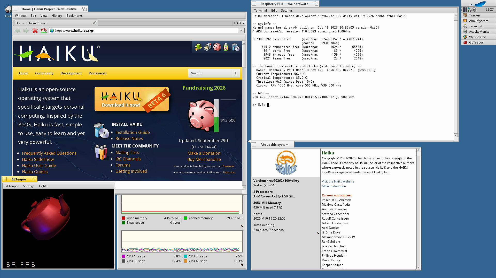
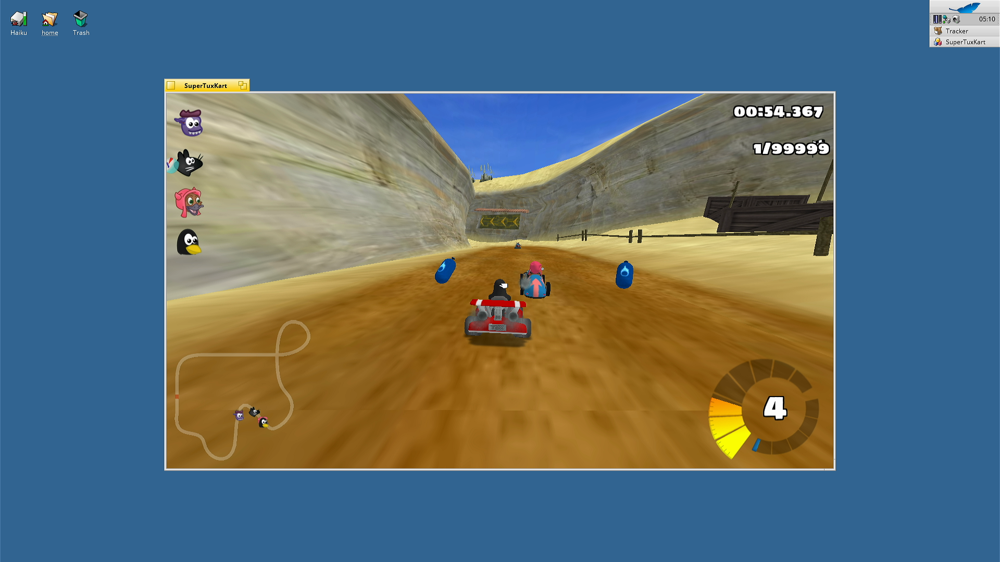
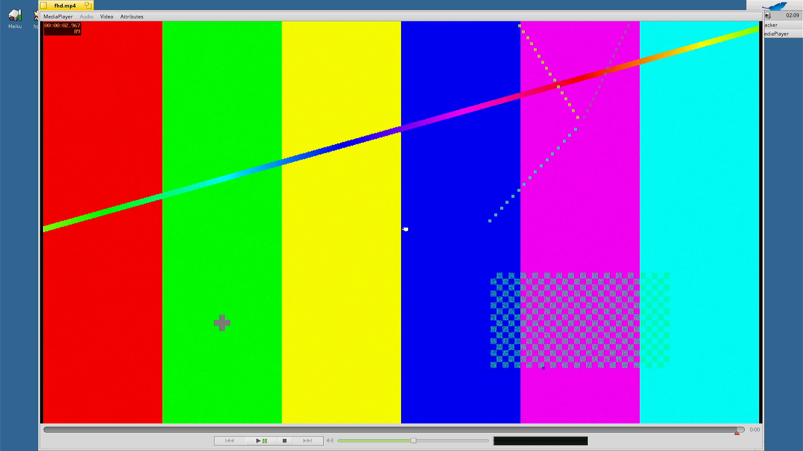
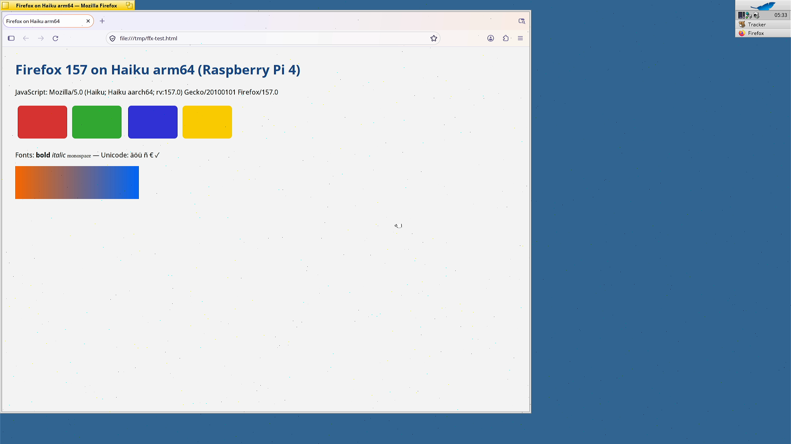

# Haiku on the Raspberry Pi 4 — User Guide

This guide is for someone who has this port's Haiku image on an SD card and wants to use it on a
Raspberry Pi 4. It covers booting, the desktop, the GPU (OpenGL, OpenGL ES, Vulkan), the games,
video and audio, the web browsers, networking (Ethernet, WiFi, Bluetooth, NFS), USB and storage,
installing software, the CPU clock and temperature, and the kernel debugger. It ends with a
[troubleshooting](#14-troubleshooting) table drawn from problems met on the bench.

Every number below was measured on the project's bench Pi (a 4 GB Raspberry Pi 4 Model B, rev 1.1)
and carries the date of its measurement. "Untested" means exactly that: nobody has tried it yet.

To build the image or write it to a card, see [TRY-IT.md](TRY-IT.md). For the plan and the
milestones, see [PLAN.md](PLAN.md); for day-by-day progress, the weekly logs in [log/](log/).

If you are new to Haiku: Haiku is an open-source operating system that continues BeOS. It has one
desktop, built in: the **Deskbar** (the panel with the menu and the list of running programs), the
**Tracker** (the file manager, which also draws the desktop and its icons) and the **app_server**
(the window system). Settings live in **Preferences** programs. Software comes as **packages**
(`.hpkg` files) that are activated, not unpacked; `pkgman` installs them.

**Contents**

1. [What you need](#1-what-you-need)
2. [Booting](#2-booting)
3. [Which image has what](#3-which-image-has-what)
4. [The desktop](#4-the-desktop)
5. [Graphics: OpenGL, OpenGL ES and Vulkan](#5-graphics-opengl-opengl-es-and-vulkan)
6. [Games](#6-games)
7. [Video and audio](#7-video-and-audio)
8. [The web](#8-the-web)
9. [Networking](#9-networking)
10. [USB, storage and other hardware](#10-usb-storage-and-other-hardware)
11. [Software and packages](#11-software-and-packages)
12. [The CPU, clocks and temperature](#12-the-cpu-clocks-and-temperature)
13. [The kernel debugger over serial](#13-the-kernel-debugger-over-serial)
14. [Troubleshooting](#14-troubleshooting)

---

## 1. What you need

| Item | Notes |
|---|---|
| **Raspberry Pi 4 Model B** | Only a **4 GB** board (rev 1.1) has been used. The 1 GB, 2 GB and 8 GB boards are untested. |
| **microSD card** | The regular image is about 1.1 GB, the image with the games about 1.8 GB. A UHS-I card gives the full speed (§10.2): the driver switches it to 1.8 V signalling (DDR50). A card without UHS-I runs in the older high-speed mode (19 MB/s reads were measured in that mode on 2026-10-18, before later driver speed-ups). |
| **Power supply** | A USB-C supply adequate for the Pi 4. If it is not, the temperature device reports `under-voltage` (§12). |
| **HDMI monitor** | One monitor on one micro-HDMI port. The bench uses a 1920×1080 monitor; the desktop runs at the monitor's native mode, read from its EDID. Other native resolutions and two monitors are untested. |
| **USB keyboard and mouse** | On the bench a Logitech K120 keyboard and a Pixart optical mouse **enumerate** and get their input devices (2026-10-20). Typing and pointing by hand have **not** been checked yet. |
| **Network** (optional) | Wired Ethernet with a DHCP server, or WiFi (WPA2-PSK, §9.2). The Pi has no battery clock: the image sets the time over NTP once the network is up, and HTTPS needs that (§8.1). |
| **Serial adapter** (optional) | A 3.3 V USB-serial adapter on GPIO 14/15, **115200 8N1**. It shows the boot log and the kernel log, and gives you the kernel debugger (§13). There is no shell on it. |
| **Headphones** (optional) | On the 3.5 mm jack (§7.3). There is no HDMI audio. |

## 2. Booting

### 2.1 Write the card and power on

Write the image to the card as [TRY-IT.md](TRY-IT.md#flash-and-boot) shows (`dd`, all data on the
card is lost). Put the card in the Pi, connect the monitor, the keyboard and mouse and the Ethernet
cable, then power on.

### 2.2 What you see

| When | HDMI | Serial console |
|---|---|---|
| first | the firmware's rainbow screen | the firmware's messages |
| then | U-Boot's text, briefly | U-Boot's log; it starts the Haiku loader (`EFI/BOOT/BOOTAA64.EFI`) |
| next | the Haiku boot splash; its icons light up one by one as the boot advances | the loader's log, then the kernel log: CPUs, drivers, the boot volume (`Mounted boot partition: /dev/disk/mmc/0/1`) |
| ~80 s | the desktop: Deskbar at the top right, the Tracker's desktop icons | `bcm2711_display: hardware cursor shown` and the servers' messages |

The boot chain is: the Pi firmware (`start4.elf`, `config.txt` on the card's FAT partition) →
U-Boot (it provides UEFI and the device tree) → `haiku_loader.efi` → the Haiku kernel and its modules
from the card's BFS partition. BFS is Haiku's file system.

**Timings** (bench Pi, SD card): the desktop appears **about 80 s** after power-on (2026-10-19/20).
The **first boot** of a freshly written card takes a little longer: the package daemon processes the
packages once. There is no language prompt: the image ships English locale settings, so the first
boot goes straight to the desktop.

**Boot order.** If the Pi's EEPROM boot order tries the network before the SD card and nothing
answers on the network, the firmware waits about a minute before it boots the card (seen on the bench
on 2026-10-18). With the factory boot order this does not apply.

**Reliability.** The SD boot bench of the regular image reached the desktop in 10 out of 10 boots
(2026-10-19) and in every 3- and 5-boot bench of later builds through 2026-10-21.

### 2.3 Booting from the network instead

For development, the Pi can also boot an image straight from a Linux build host, with no SD card
writing: the firmware loads its files and U-Boot by TFTP, and the Haiku loader and kernel read the
boot volume from the host as a remote disk. The desktop then appears after **~55–60 s** (2026-10-20/21).
This needs the host-side scripts; see [TRY-IT.md](TRY-IT.md#boot-from-the-network-no-sd-card-writing)
and [design/netboot.md](design/netboot.md). It is not an NFS root: Haiku boots from a block
device. Network boots have a known rare stop (§14).

## 3. Which image has what

Three kinds of software appear in this guide. Check which one you have before you look for a
program.

| | What it contains | How it is made |
|---|---|---|
| **The regular image** (`haiku-pi4-regular.img`) | Haiku's full desktop: Deskbar, Tracker, Terminal, all applications and preferences, the media kit and MediaPlayer; this port's drivers; Mesa (OpenGL, OpenGL ES, Vulkan); GLTeapot, GLInfo and three GL screen savers; SDL2; ffmpeg 6.1; WebPositive, Firefox 157 and NetSurf; OpenSSL 3, curl, CA certificates; Python 3.14 | `scripts/build.sh -sHAIKU_PI_GL=1 @pi-mmc` ([TRY-IT.md](TRY-IT.md#build-the-image)) |
| **The image with the games** | everything above, plus **OpenArena** and **SuperTuxKart** in the Applications menu | the same with `-sHAIKU_PI_GAMES=1` (about 1.8 GB). Both are also in the public repository: `pkgman install openarena supertuxkart` (their data comes in parts) |
| **Test trees** | QuakeSpasm, Yamagi Quake II, vkQuake (and Quake III Arena with your own data), llama2.c, the Rust test programs, the HEVC test clips | built on the host (`scripts/build-games.sh`, `scripts/build-llama2.sh`, ...) and copied into an image with `scripts/mkimage-pi4.sh --add-tree`. They land in `/boot/system/non-packaged/`. The Quake games need id Software's data (the free shareware/demo files), which cannot be redistributed in a package |

Everything in this guide that names a test tree says so.

## 4. The desktop



### 4.1 Deskbar, Tracker and Terminal

- **Deskbar** is the panel at the top right of the screen. Its leaf menu opens **Applications**,
  **Preferences**, **Demos** and the other system menus. Below the menu it lists the running
  programs.
- **Tracker** is the file manager. Your home folder is `/boot/home`; the user is called `user`,
  and the machine's host name is `shredder` (Haiku's defaults for a built image).
- **Terminal** (Applications → Terminal) runs bash. The commands in this guide are typed there.
- **About Haiku** (in the leaf menu) shows "4 Processors: ARM Cortex-A72 @ 1.50 GHz" and 3956 MiB of
  memory on the 4 GB board (2026-10-20).
- **ActivityMonitor** and **ProcessController** (both in Applications) show the load of the four
  cores. Since 2026-10-20 they tell user time from kernel time correctly (§12.3).

### 4.2 Screen preferences and resolutions

Open **Preferences → Screen**. The resolution menu lists every mode **up to the monitor's native
one** (`screenmode -l` lists 40+ modes on the bench monitor). The refresh rate is 60 Hz.

How a lower mode works: the HDMI link always stays at the native mode (1920×1080 on the bench).
A smaller mode gets its own frame buffer, which the Pi firmware's display plane scales up to the
whole screen, keeping the aspect ratio and centring the picture. So:

- **1280×720** on a 16:9 monitor fills the whole screen;
- **1024×768** (4:3) is shown in the middle with black bars at the sides (pillarboxed).

Both, and the return to the native mode, were checked on HDMI (2026-10-19). From Terminal:

```sh
screenmode -l             # list the modes
screenmode -q 1280 720    # switch to 1280x720 without the confirmation dialog
screenmode -q 1920 1080   # back to the native mode
```

The vertical retrace (what programs wait for to draw without tearing) runs at **60.00 Hz**, in the
native mode and in scaled modes (2026-10-19).

### 4.3 The mouse pointer

The pointer is a **hardware cursor**: a firmware display plane on top of everything, moved with one
firmware call per move, so it stays smooth while the CPU or the GPU is busy. It scales with a lower
mode (1.5× at 1280×720) and is clipped at the screen edges. It was checked with a program moving the
pointer to the centre, the corners and around a circle (2026-10-19); a check with a real mouse in
hand is still open.

### 4.4 Language, keyboard and time

The image ships English locale settings and the Time preferences' "synchronize at boot" setting, so
the clock is set over NTP once the network comes up. Change the language, keyboard layout and time
zone in **Preferences → Locale**, **Keymap** and **Time**, as on any Haiku system. Other keyboard
layouts are untested on the Pi.

## 5. Graphics: OpenGL, OpenGL ES and Vulkan

### 5.1 What the GPU offers

The Pi 4's GPU, the **V3D 4.2**, is driven by this port's kernel driver and **Mesa 26.2.0**:

| API | Version | Notes |
|---|---|---|
| **OpenGL** (desktop) | **2.1** | what a Haiku GL window (`BGLView`) gets by default: a compatibility context. Programs that need desktop OpenGL 3.2 or newer do not run (for example Yamagi Quake II's GL3 renderer). |
| **OpenGL ES** | **3.1** (GLSL ES 3.10) | for programs that ask for it: SDL2 programs with an ES profile, Firefox's WebGL, SuperTuxKart-GLES. Since 2026-10-20. |
| **Vulkan** | **1.3** (Mesa's V3DV, 90 extensions) | in Haiku windows and SDL2's Vulkan windows. Since 2026-10-20. |

The renderer string is `V3D 4.2.14.0`. A frame reaches the screen without a CPU copy: the GPU
writes it straight into the window's memory (2026-10-19).

**In the regular image:**

- **GLTeapot** and **GLInfo**, Haiku's own GL demos, are in `/boot/system/non-packaged/apps/`
  (they have no Deskbar entry: open that folder in Tracker, or start them from Terminal).
  GLTeapot shows about **59–60 frames/s**: it waits for the retrace (2026-10-19).
- The GL screen savers **Flurry**, **GLife** and **Gravity** are in
  `/boot/system/non-packaged/add-ons/Screen Savers/`; pick them in **Preferences → ScreenSaver**.

```sh
/boot/system/non-packaged/apps/GLTeapot &
/boot/system/non-packaged/apps/GLInfo &
```

### 5.2 Measured rates

| Test (window) | Rate | Date |
|---|---|---|
| A GL triangle in a 400×400 / 600×600 / 800×800 / 1000×1000 window (`glview`, test tool) | 512 / 239 / 153 / 105 frames/s | 2026-10-19 |
| The same with a CPU copy instead of the GPU's direct write (for comparison) | 346 / 159 / 60 / 39 frames/s | 2026-10-19 |
| A 256×256 GL window, 5 minutes on end | 485.6 frames/s, 0 GPU resets | 2026-10-18 |
| An OpenGL ES 3.1 triangle in a 256×256 window | ~1500 frames/s | 2026-10-20 |
| A Vulkan cube (`vkcube`, test tool), 640×480 / 1600×900, FIFO | 403 / 111 frames/s | 2026-10-20 |

The direct write presents about 100 megapixels per second at every window size. The games are
in §6.

### 5.3 Seeing a program's frame rate

Two environment variables make Mesa print the frame rate of what a program presents, every few
seconds, on its standard output. Start the program from Terminal:

```sh
HAIKU_EGL_FPS=1 /boot/system/non-packaged/apps/GLTeapot     # OpenGL / OpenGL ES programs
HAIKU_VK_FPS=1 ./vkquake ...                                 # Vulkan programs
```

`V3D_DEBUG=perf` makes Mesa's V3D driver report where it waits (for example "Blocking on resource BO
for bo map").

## 6. Games

### 6.1 What exists

| Game | Engine / API | Where |
|---|---|---|
| **OpenArena 0.8.8** | ioquake3 (the Quake III engine), SDL2 + OpenGL 2.1 | image with the games: Applications → OpenArena (`/boot/system/apps/OpenArena`) |
| **SuperTuxKart 1.5** | SDL2; `SuperTuxKart` = OpenGL 2.1 (legacy renderer), `SuperTuxKart-GLES` = OpenGL ES 3.1 (shader renderer) | image with the games: Applications → SuperTuxKart (`/boot/system/apps/SuperTuxKart`) |
| **QuakeSpasm 0.96.3** | SDL2 + OpenGL | test tree, `/boot/system/non-packaged/apps/QuakeSpasm` (shareware data) |
| **Yamagi Quake II 8.60** | SDL2 + OpenGL (GL1 renderer) | test tree, `/boot/system/non-packaged/apps/quake2` (demo data) |
| **vkQuake 1.35.0** | SDL2 + **Vulkan** | test tree, `/boot/system/non-packaged/apps/vkQuake` (shareware data) |
| **Quake III Arena** | ioquake3 | test tree, only with your own Quake III data (`QUAKE3_DATA` when building) |

OpenArena and SuperTuxKart bring all their (free) data. The Quake engines need id Software's data
files, which is why they are not packaged.

### 6.2 Measured frame rates

| Game | Setting | Frames/s | Date |
|---|---|---|---|
| QuakeSpasm, demo1 | 640×480 window | 66–72 | 2026-10-19 |
| | 1280×720 window | 56–70 | 2026-10-19 |
| | 1920×1080 | 30–43 (GPU-bound) | 2026-10-19 |
| Yamagi Quake II, GL1, attract demo | 640×480 window | 135–171 | 2026-10-19 |
| | 1280×720 window | 81–89 | 2026-10-19 |
| vkQuake, timedemo demo1 | 1280×720 window | 52.2 | 2026-10-20 |
| OpenArena, timedemo `demo088-test1` | 1280×720 window | 46.1 | 2026-10-20 |
| | 1280×720 **full screen** (display mode switched) | 46.8 | 2026-10-20 |
| | 1920×1080 full screen / borderless | 22–29 | 2026-10-20 |
| SuperTuxKart (legacy GL 2.1), 4-kart race on Hacienda | 1280×720 window | 28–38 | 2026-10-20 |
| SuperTuxKart-GLES (shaders: lighting, sky), same race | 1280×720 window | 16–18 | 2026-10-20 |
| SuperTuxKart `--benchmark` (Black Forest, the heaviest track) | 1280×720 window, legacy | typical 5 | 2026-10-20 |

The rates come from the games' timedemos or from Mesa's presented-frame counter (§5.3). At
1920×1080 QuakeSpasm keeps the GPU ~95 % busy (2026-10-20).



More pictures: [QuakeSpasm full screen at 1080p](screenshots/04-quakespasm-fullscreen-1080p.png),
[Quake II in a window on the desktop](screenshots/02-desktop-quake2.png),
[vkQuake on Vulkan](screenshots/06-vkquake-vulkan-window.png),
[OpenArena](screenshots/08-openarena-ioquake3.png),
[SuperTuxKart's shader renderer](screenshots/12-supertuxkart-gles-shaders.png).

### 6.3 Starting the games

**OpenArena and SuperTuxKart** start from **Applications** in the Deskbar. You can also start them from
Terminal with options:

```sh
cd /boot/system/apps/OpenArena
./OpenArena +set r_mode -1 +set r_customwidth 1280 +set r_customheight 720 +set r_fullscreen 0 +set cg_drawFPS 1

cd /boot/system/apps/SuperTuxKart
./SuperTuxKart --windowed --screensize=1280x720 --disable-texture-compression
./SuperTuxKart-GLES --windowed --screensize=1280x720 --disable-texture-compression
```

- `cg_drawFPS 1` shows OpenArena's frame rate on screen. OpenArena's own benchmark:
  `+set timedemo 1 +demo demo088-test1 +set nextdemo quit` (3398 frames, then it quits).
- SuperTuxKart runs an AI-only race and exits with
  `--profile-time=60 --track=hacienda --numkarts=4 --kart=tux --difficulty=0`; its benchmark is
  `--benchmark`. The test runs pass `--disable-texture-compression`, which keeps the texture
  compression off the CPU at load time.
- SuperTuxKart's shader renderer needs OpenGL ES 3: the plain `SuperTuxKart` says "OpenGL version is
  too old" for it and uses the legacy renderer, which is faster on the V3D but less lit.
- OpenArena's game code runs in ioquake3's QVM **interpreter**: there is no arm64 QVM compiler.

**The Quakes** (test trees), in Terminal:

```sh
cd /boot/system/non-packaged/apps/QuakeSpasm && ./quakespasm -basedir . -window -width 1280 -height 720
cd /boot/system/non-packaged/apps/quake2 && ./Quake2 +set vid_renderer gl1
cd /boot/system/non-packaged/apps/vkQuake && ./vkquake -basedir . -window -width 1280 -height 720
```

- Quake II: use the **GL1** renderer. Its GL3 renderer needs desktop OpenGL 3.2 (§5.1).
- vkQuake's image ships `id1/autoexec.cfg` with `r_oit 0` and `r_gpulightmapupdate 0` (no extra
  transparency passes, lightmaps updated on the CPU): with them it runs at 52 frames/s instead of 29
  at 1280×720 (2026-10-20). Keep them if you write your own config.
- A timedemo (`+timedemo demo1`) prints its result to the console; add `-condebug` to have it in
  `qconsole.log` as well, which survives the game being killed.

### 6.4 Window or full screen; a lower resolution for more frames

Every game runs in a window next to your other windows, or full screen. Full screen **at a lower
resolution** switches the display mode, and the firmware scales the picture to the monitor (§4.2).
This trades sharpness for frame rate: OpenArena full screen at 1280×720 ran at **46.8 frames/s**
against **26** at the native 1920×1080, and the desktop went back to 1920×1080 when the game quit
(2026-10-20).

```sh
cd /boot/system/apps/OpenArena
./OpenArena +set r_mode -1 +set r_customwidth 1280 +set r_customheight 720 +set r_fullscreen 1
```

`+set r_mode -2 +set r_fullscreen 1` instead runs full screen at the desktop's resolution, with no
mode switch. Any SDL2 game that asks for a full-screen display mode gets the same switch.

### 6.5 Input and sound in games

- Keyboard and mouse in SDL games go through SDL's event queue on the game's own thread (since
  libsdl2 2.32.10-5, 2026-10-20). Playing by hand is still on the owner's check list: untested.
- SuperTuxKart runs with its sound on (MojoAL on SDL2's audio); whether it is heard at the jack is
  untested. The Quake test runs and the OpenArena benchmark turn sound off; sound in them is untested.

## 7. Video and audio

### 7.1 MediaPlayer and the codecs

**MediaPlayer** (Applications → MediaPlayer) plays files through Haiku's media kit, whose ffmpeg
plugin uses **ffmpeg 6.1**, whose decoders cover Ogg/Vorbis, MP3, AAC, H.264, VP8, VP9 and more.
Played on the Pi so far: Ogg Vorbis and HEVC in MediaPlayer, H.264, VP9, AV1 and HEVC in Firefox
(§8.2); the other formats are untested. Open a file from MediaPlayer's File menu, or drop it on the
window. From Terminal:

```sh
/boot/system/apps/MediaPlayer /path/to/clip.mp4 &
```

The system sounds and the MIDI soundfont are in the image. The ffmpeg build has its own decoders
and libvorbis; the recipe's other external libraries are not ported yet.

### 7.2 HEVC on the hardware decoder

The BCM2711 has a hardware HEVC (H.265) decoder. This port's driver (`/dev/video/rpivid/0`) and a
libavcodec decoder, `hevc_rpivid`, use it automatically: MediaPlayer, Firefox and any media-kit
program decode HEVC on the hardware with no setting. A stream the block cannot take is decoded on
the CPU instead.



Measured with a decoding benchmark (2026-10-20; every picture bit-exact against FFmpeg's CPU
decoder, 2324 pictures, 0 failures):

| Stream | Hardware block | CPU decoder, 4 threads | CPU time per frame, block vs CPU |
|---|---|---|---|
| 720p, light | 418 frames/s | 140 frames/s | 1.7 vs 20.8 ms |
| 1080p, 20 Mbit/s | **114.8 frames/s** | 25.5 frames/s | 4.0 vs 127 ms |
| 1080p, Main 10 | 80.4 frames/s | 20.3 frames/s | 9.1 vs 166 ms |
| 2160p (4K), 30 Mbit/s | **38.2 frames/s** | 6.0 frames/s | 18.4 vs 330 ms |
| 2160p, Main 10 | 23.7 frames/s | 8.0 frames/s | 35.8 vs 431 ms |

The 1080p stream decodes on less than half a core. Re-measured after the clock changes of
2026-10-20: 1080p 114.6, 4K 38.1 frames/s.

**Limits:**

- HEVC **Main** and **Main 10**, 4:2:0, 32 to 4096 pixels per side. Range extensions and screen
  content coding are not supported by the block.
- **H.264 is decoded on the CPU.** On the Pi 4 the H.264 hardware sits behind the VideoCore
  firmware, which this port does not drive. The CPU is fast enough for files: FFmpeg decodes 300
  frames of 1080p H.264 in 2.9 s on four threads, several times real time (2026-10-20).
- MediaPlayer converts every decoded frame to RGB on the CPU before showing it; showing the
  decoder's output directly is future work.

### 7.3 Audio: the 3.5 mm jack

The headphone jack is driven by the Pi's PWM audio (this port's `bcm2711_pwm` driver). The media
kit picks it as its default output, **"Raspberry Pi headphones"**, 44.1 kHz stereo. Choose outputs
in **Preferences → Media**.

- Measured (2026-10-19): the hardware streams at 44117.66 Hz (it is clocked at 44117.647 Hz and
  advertises 44100), **0 underruns** over 128 periods; a test tone and MediaPlayer playing a system
  sound both streamed through it.
- **Nobody has listened to it yet**: it was measured, not heard.
- **No HDMI audio.**

## 8. The web

### 8.1 First: the clock

The Pi has no battery-backed clock. It starts in 1970, and HTTPS then fails with "certificate not
yet valid". The image's Time settings synchronize the clock over NTP when the network comes up, so
normally you need do nothing. To set it by hand, once the network is up:

```sh
/boot/system/preferences/Time --update
date
```

### 8.2 Firefox

**Firefox 157** (HaikuPorts' native Haiku Firefox, an x86_64 port upstream, cross-built for arm64 by
this project) is in the regular image: **Applications → Firefox**, or `/boot/system/apps/Firefox/Firefox`.



| Measurement (2026-10-20) | Result |
|---|---|
| First start (it creates the profile and the font cache) | 16 s |
| Later starts showing a local page | 5.9–6.3 s, mostly Firefox's own start |
| Later starts showing https://www.haiku-os.org/ | 8.1–9.6 s |
| WebGL | **WebGL 1 and WebGL 2**, renderer "Broadcom", on an OpenGL ES 3.1 context |
| Video it says it can play (`canPlayType`) | "probably": H.264, HEVC, VP8, VP9, AV1 (MP4/WebM), Vorbis, Opus; "maybe": MP3; no Theora |

Video playback, 10-second test clips in a window (2026-10-20; frames dropped of the total):

| Clip | Decoded by | Dropped |
|---|---|---|
| VP9 720p | Firefox's own decoder | 10–16 of 300 |
| AV1 720p | Firefox's own decoder | 11–15 of 300 |
| HEVC 720p | the **hardware decoder** (§7.2), through the system ffmpeg | 2–32 of 150 |
| H.264 720p | the system ffmpeg, on the CPU | 121–211 of 300 |
| H.264 1080p | the system ffmpeg, on the CPU | 148–271 of 300 (149 with a test setting, below) |

**Limits:**

- **The first video after Firefox starts drops frames.** The table above is from first plays on
  network boots. The same H.264 clip played a second time drops 14 of 300 (network boot) and **0 of
  300 from the SD card** (2026-10-21); VP9 played first drops as much as H.264. Firefox's decoder
  process stalls for up to 1.8 s at a time while it warms up, and the frames it delivers late are
  discarded. If a video stutters at first, play it again.
- WebRTC is untested.
- Firefox is in the public package repository too (`pkgman install firefox`, 102 MB).
- Its user agent says "Haiku aarch64".

Headless use, for example from a script: `Firefox --headless --screenshot page.png <url>`.

### 8.3 WebPositive

**WebPositive** (Applications → WebPositive) is Haiku's own browser, on **HaikuWebKit 1.10** with
JavaScriptCore's JIT on. It renders https://www.haiku-os.org/ completely (2026-10-19, and again with
the rebuilt ICU on 2026-10-20). A JavaScript loop that takes 7 s without the JIT takes 1 s with it.


Limits: the Web Inspector's files are not installed (as on x86 Haiku; the HaikuPorts recipe leaves them out). Its user agent says "Macintosh; Intel Haiku/…"
on purpose: upstream's Haiku WebKit poses as Safari for site compatibility, and Safari on Apple Silicon
Macs also says "Intel".

### 8.4 NetSurf and curl

**NetSurf 3.11** (Applications → NetSurf) is a small, fast browser without JavaScript. It showed
https://www.haiku-os.org/ fully rendered in 1.2 s (2026-10-19).

`curl` in Terminal speaks HTTPS through OpenSSL 3 with the system's CA certificates: TLS 1.3,
certificate verified, the haiku-os.org page in 0.25 s (2026-10-19).

## 9. Networking

### 9.1 Ethernet

The gigabit port gets its address by DHCP at boot, through Haiku's `net_server`. **Preferences →
Network** shows and changes the settings; `ifconfig` in Terminal shows them. The interface is
`/dev/net/genet/0`.

| Date | Upload | Download | |
|---|---|---|---|
| 2026-10-18 | 623 Mbit/s | 250 Mbit/s | first driver |
| 2026-10-19 | 618 Mbit/s | 735 Mbit/s | receive buffers cached |
| **2026-10-21** | **914 Mbit/s** | **918 Mbit/s** | the kernel's lighter debug level; TCP over gigabit tops out near 940 |

### 9.2 WiFi

The on-board BCM43455 works on 2.4 GHz WPA2-PSK networks. The interface is
`/dev/net/broadcomfmac/0`. From Terminal:

```sh
ifconfig /dev/net/broadcomfmac/0 up
ifconfig /dev/net/broadcomfmac/0 scan
ifconfig /dev/net/broadcomfmac/0 join "<network name>" "<passphrase>"
ifconfig /dev/net/broadcomfmac/0          # after a few seconds: the DHCP address
```

- Verified on the bench (2026-10-19): **3 of 3 joins** with DHCP and pings of 7–8 ms to the access
  point; throughput **37 Mbit/s up, 46 down**, close to the limit of the bench's 2.4 GHz access
  point.
- There is no `wpa_supplicant` for arm64 yet. The kernel's WiFi stack derives the key and does the
  WPA2 handshake itself; `net_server` joins as WPA2-PSK. Open networks, WPA3, enterprise (802.1X)
  networks and 5 GHz networks are untested.
- **Preferences → Network** takes the same path, but joining from it has not been tried by hand.
- Whether a joined network is remembered across reboots is untested.
- The firmware files come from linux-firmware (Cypress 43455, with the Pi 4's NVRAM file) and sit in
  `/boot/system/non-packaged/data/firmware/broadcomfmac/`.

### 9.3 Bluetooth

The BCM43455's Bluetooth works through Haiku's Bluetooth stack: the driver uploads the controller's
firmware patch at every open, then the stack reads its address, name and features and can run an
inquiry. Nothing starts the Bluetooth server at boot (as on other Haiku systems); start it from
Terminal:

```sh
/boot/system/servers/bluetooth_server &
```

- Verified (2026-10-19): the patch (323 of 323 records acknowledged), the controller's address and
  name ("BCM43455 37.4MHz Raspberry Pi 3+-0190"), and an inquiry through Haiku's discovery API that
  ran to completion (it found nothing: no device near the bench was discoverable).
- Each open of the device takes about **7 s** (the firmware patch).
- **Pairing a device is untested**, and so are Bluetooth keyboards, mice and audio.
- Haiku's own command-line tools are broken upstream: `bt_dev_info` prints its name field wrongly,
  `bt_discovery` does not compile. The Bluetooth preferences have not been tried.

### 9.4 NFS client

Haiku's NFSv4 client mounts an export from another machine:

```sh
mkdir -p /nfs
mount -t nfs4 -p "<server>:/" /nfs
ls /nfs
df /nfs
```

Verified on 2026-10-18: the listing and `df`'s sizes are correct. Two cosmetic "NFS Error" lines
are printed, and `df`'s device field shows garbage characters. Speed over NFS has not been measured.

There is no SSH server or client in the image yet (openssh is not built for arm64). To copy files to
the Pi, use NFS, `curl` from a web server, or a USB stick (§10.1).

## 10. USB, storage and other hardware

### 10.1 USB

The Pi 4's USB ports hang off a VL805 controller on PCIe, which this port drives: USB 2 and USB 3,
hubs, keyboards, mice and storage. `listusb` lists the devices.

- Keyboard and mouse: they get `/dev/input/keyboard/usb/0` and `/dev/input/mouse/usb/0` (2026-10-20).
  The serial log line "no handlers" for the keyboard is its second, multimedia-keys interface, and
  is harmless. **Typing and pointing are untested by hand.**
- USB storage: a stick appears as `/dev/disk/usb/0/0/raw`. Raw reads from a USB 3 stick ran at
  **78–90 MB/s** (2026-10-18/19).
- Mounting a stick's file system (FAT, BFS, ...) uses Haiku's ordinary mounting, but it has not been
  tried on the Pi: only raw reads were measured. Hot-plugging is untested.

### 10.2 The SD card

The SD card runs at UHS-I DDR50 (1.8 V signalling, 50 MHz) with one DMA command per transfer:

| Measurement (2026-10-20) | Speed |
|---|---|
| Raw sequential reads | **42.6 MB/s** (the bus limit is 50) |
| Reading a large package through the file cache | 44 MB/s |
| Writes | 29–36 MB/s |

Higher modes (SDR104) are out of reach: the controller's base clock is 100 MHz. A 20-minute soak with
22 write-and-verify passes of 64 MiB had 0 errors (2026-10-19).

### 10.3 GPIO

The GPIO driver publishes `/dev/gpio/bcm2835/0` with a text interface. Reading the device lists the pin
table, one line per pin; writing a command sets a pin:

```sh
cat /dev/gpio/bcm2835/0                    # the pin table
echo "out 21 1" > /dev/gpio/bcm2835/0      # pin 21: output, high
echo "out 21 0" > /dev/gpio/bcm2835/0      # pin 21: output, low
echo "in 21" > /dev/gpio/bcm2835/0         # pin 21: input
```

Only pin 21 has been exercised (output high, output low, input; 2026-10-18). Do not drive the pins
the board itself uses (the WiFi chip sits on pins 34–39).

### 10.4 Random numbers

The BCM2711's hardware random number generator feeds the kernel's random pool, so `/dev/random`
mixes in hardware entropy (2026-10-20). There is no separate device for it.

## 11. Software and packages

### 11.1 pkgman and the repositories

`pkgman` works out of the box. The image knows two repositories:

- **Haiku's own arm64 system repository**, and
- **this project's repository**, [haiku-pi.github.io/packages](https://github.com/haiku-pi/packages)
  (`https://haiku-pi.github.io/packages/arm64`): arm64 builds of HaikuPorts recipes, since there is no
  official arm64 HaikuPorts repository.

```sh
pkgman refresh
pkgman list-repos
pkgman search -a mesa
pkgman install sqlite_devel
```

Both repositories and `pkgman install sqlite_devel` over HTTPS worked on the Pi on 2026-10-20.

**What our repository has** (113 packages on 2026-10-21): Firefox 157; the games OpenArena and
SuperTuxKart (their data in parts); Mesa and GLU; SDL2; ffmpeg 6.1 with the HEVC hardware decoder;
HaikuWebKit and the libraries it needs (brotli, dav1d, lcms, libavif, libwebp, libxml2, libxslt, sqlite,
woff2, ...); NetSurf; OpenSSL 3 and curl; ICU 74; Python 3.14 with libedit and ncurses; zstd;
libogg, libvorbis, fluidlite; gzip, tar, bzip2, unzip; and the `_devel` packages (headers and link
libraries) of most of them.

**Command-line tools** (since 2026-10-21): `pkgman install nano vim git wget rsync openssh htop_rivoreo`
— nano 9.1, vim 9.1 (console), git 2.56 (no Perl or Python helpers), wget 1.24 (HTTPS), rsync 3.2,
OpenSSH 10.6 (ssh, ssh-keygen, sshd; the host keys are generated when the package is activated) and htop
2.3. On the Pi, after installing them from the repository: a git repository initialised and a commit made,
an rsync copy, an edit with vim, an ed25519 key made, `sshd -t` passing, a file fetched with wget
(`tools/pi-tests/cli-tools.sh`).

**What it does not have:** the Quake engines (their game data is not free; §6 shows how to build them). The repository is not signed; Haiku does not check repository signatures today.

### 11.2 Python 3.14

CPython **3.14.8** is in the regular image. Start it as `python3.14`:

```sh
python3.14
```

- The interactive prompt has line editing and history (`readline`, on libedit), and `curses` works
  (ncurses 6.6, 256 colours in Terminal) (2026-10-20).
- Checked on the Pi (2026-10-20): `ssl` (OpenSSL 3.5.9), `sqlite3`, `ctypes`, `zlib`/`bz2`/`lzma`/
  `zstd`, `decimal`, `json`, sockets, `subprocess`, threads. `sum(range(10**7))` takes 1.3 s.
- `pip` has not been tried.

### 11.3 Developing programs

- **C and C++ on the Pi itself**: a separate development image (`-sHAIKU_PI_DEV=1`, see
  `tools/build/UserBuildConfig`) has gcc 13, binutils, make, Python 3.10 and haikuporter; gcc builds
  and runs C and C++17 programs on the Pi (a compile takes ~2 s; 2026-10-19). The regular image has no
  compiler.
- **Cross-compiling from Linux**: the build tree's arm64 cross gcc builds Haiku programs. C++
  programs built with it before 2026-10-20 could not catch exceptions (every `throw` ended the
  program); the fixed toolchain links `libgcc_s` as needed.
- **Rust**: `scripts/build-rust.sh` builds, on the Linux host, rustc **1.90.0** with the standard
  library for the target `aarch64-unknown-haiku`, and the official cargo. Source its `env.sh` to get
  `rustc` and `cargo` with the target's linker set, then build with `--target aarch64-unknown-haiku`.
  Programs using threads, files, TCP, timeouts, panics, child processes, and C programs linking a Rust
  static or shared library, all passed on the Pi (2026-10-20). There is no Rust compiler on the Pi
  itself.

### 11.4 llama2.c (test tree)

Andrej Karpathy's llama2.c generates text with the small TinyStories language models, on the CPU
(`scripts/build-llama2.sh`, a test tree with `llama2-run` using OpenMP and `llama2-run-st` on one
core):

```sh
cd /boot/system/non-packaged
bin/llama2-run data/llama2/stories15M.bin -z data/llama2/tokenizer.bin -n 256 -i "Once upon a time"
```

| Model | 4 cores (OpenMP) | 1 core | Date |
|---|---|---|---|
| stories15M | **45.7 tok/s** | 28.9 tok/s | 2026-10-20 |
| stories260K | 318 tok/s | 996 tok/s | 2026-10-20 |

More threads barely help stories15M: every token streams the 60 MB of weights from memory (about
2.7 GB/s). For the tiny stories260K model, thread overhead dominates.

### 11.5 Windows programs (Wine)

Wine 11.20 runs Windows programs on Haiku arm64. Programs built for 64-bit Arm Windows run directly;
32-bit x86 Windows programs (most older games and applications) run through WoW64 and the Box64
emulator. Install both packages from our repository:

```sh
pkgman install wine wine_x86
```

- `wine` (75 MB download, ~550 MB installed): the Unix side, the 64-bit Arm Windows libraries, and
  Wine's fonts and data. pkgman also installs the window driver's Wayland libraries (wayland,
  wayland_server, libxkbcommon, xkeyboard_config) and Mesa.
- `wine_x86` (66 MB download, ~190 MB installed): the 32-bit x86 Windows libraries and Box64 0.4.4's
  `wowbox64.dll` (also installed as `xtajit.dll`). Leave it out if you only run Arm programs.

The packages were built on 2026-10-22 (`scripts/build-wine.sh`) and are in our repository with the Wayland
packages they need. The first start asks to install Wine Mono (.NET); Cancel is fine for most programs.

Run a program from Terminal:

```sh
wine program.exe
wine notepad          # Wine's own programs: notepad, winecfg, regedit, winemine, ...
```

The first start creates the Wine prefix `~/.wine`, the Windows `C:` drive. That takes a few minutes and
about 1 GB of disk. Windows open as normal Haiku windows.

**Programs that check free space.** Wine maps Haiku's root `/` to drive `Z:`. That file system reports no
free space, so some installers and games (Heroes of Might and Magic III, for example) refuse to start
from it. Map `/boot` to `D:`:

```sh
ln -sfn /boot ~/.wine/dosdevices/d:
```

After that, a program anywhere under `/boot` (your home folder included) runs from `D:`.

**Known limits** (2026-10-22):
- **OpenGL programs run on the V3D** (Wine's EGL driver on Mesa: OpenGL 2.1). **Direct3D and DirectDraw
  games use wined3d's software (GDI) renderer**, which is enough for 2D games (Heroes III plays) and for
  Half-Life's software renderer in a window. Its 8-bit-to-16-bit blits are wrong, so SimCity 3000's city
  view is garbled. wined3d's OpenGL renderer (`WINE_D3D_CONFIG=renderer=gl`) does not show DirectDraw
  games yet.
- Sound plays through Haiku's Media Kit (`winehaiku.drv`). Wine can play sound but not record it.
- 32-bit x86 programs run in Box64's emulator, which is slower than native code.
- Not built in: Vulkan, printing, scanners, USB devices, joysticks.
- **A crashing program** prints a crash report in Terminal (lines starting `crash:`: the registers, the
  faulting code and the call chain as `module+offset`). Wine's debugger cannot attach to a program on
  Haiku: its "Program Error" dialog only offers OK. Developers: docs/design/wine-debugging.md.
- **Before updating or removing Wine, quit every Windows program** (and `wineserver -k`): a Wine process
  left running from the old package keeps the new one from starting programs (kill it, or restart Haiku).
- 1 game start in about 5 failed to open a window (an intermittent start hang that is still being
  investigated). Close it and start the program again.

## 12. The CPU, clocks and temperature

### 12.1 The temperature device

```sh
cat /dev/power/bcm2835_thermal/0
```

It prints, from the VideoCore firmware:

- `Board:` the board as the firmware reports it, e.g. "Raspberry Pi 4 Model B rev 1.1, 4096 MB, BCM2711";
- `Current Temperature:` and `Critical Temperature:` (the firmware's limit, 85 °C);
- `Throttled:` the firmware's flags now (`under-voltage`, `frequency capped`, `throttled`,
  `soft temperature limit`) and since boot;
- `Clocks:` the measured ARM, core and V3D clocks in MHz.

Temperatures on the bench Pi: 50–52 °C idle (2026-10-18), up to 64 °C under Quake (2026-10-19), a
72–74 °C plateau in a 20-minute soak of Quake, SD writes and network traffic, **never throttled**
(2026-10-19).

### 12.2 The clock follows the load

The four Cortex-A72 cores run between **600 and 1500 MHz** (steps 600, 750, 1000, 1200, 1500). A
driver checks the load every 50 ms and asks the firmware for the lowest step that covers it; it
lowers the clock only after four checks agree (since 2026-10-20). The firmware's turbo mode is never
requested. The core clock (the GPU's memory side) is held at its maximum, **500 MHz**. The firmware
still throttles on its own if the chip gets too hot.

- Starting work from an idle clock costs little: a 0.7 s burst took 0.73 s from idle against 0.68 s
  with the clock already up (2026-10-20).
- **ProcessController**'s menu has **Power saving** (and the default, low latency): power saving
  keeps the ARM at its minimum.
- Why this matters: without a driver asking, the firmware drops the ARM to 600 MHz and the core to
  200 MHz about two minutes after power-on, for good; the games ran 1.5–1.9× slower (found
  2026-10-19).

### 12.3 Time accounting

`time` in Terminal, ProcessController and ActivityMonitor tell user time from kernel time correctly
since 2026-10-20. Before, arm64 Haiku counted nearly all user time as kernel time (a Python loop
showed `user 0.013s sys 4.32s`; now `user 4.17 s, sys 0.19 s`). Measurements of "system time" taken
before that date are wrong.

## 13. The kernel debugger over serial

Haiku has a built-in kernel debugger, **KDL** (prompt `kdebug>`). It stops the whole system, so you
can look at its state. It appears on the serial console (115200 8N1, GPIO 14/15) and on HDMI
(drawn into the current frame buffer, scaled with a lower display mode). A kernel panic enters it by
itself.

**To enter it from a running system**, type on the serial line **Ctrl-] three times, then `d`**.
This works even when the desktop no longer responds, as long as the kernel still runs. (Haiku's keyboard
equivalent is Alt+SysRq+D; with a USB keyboard on the Pi it is untested.)

Useful commands:

| Command | Shows |
|---|---|
| `help` | all commands |
| `teams` | the running programs (teams) |
| `threads` | all threads and their states |
| `cpu 1`, then `bt` | switch to CPU 1, then its stack trace (`bt` alone: the current CPU) |
| `ici` | inter-CPU messages in flight |
| `timers` | the timers pending on each CPU |
| `gic` | the interrupt controller's state |
| `arm64_timer` | the CPU's architectural timer registers |
| `continue` (or `exit`, `es`) | leave the debugger; the system runs on |

A program's own output can reach the serial console too: write to `/dev/dprintf`. A script saved as
`~/config/settings/boot/UserBootscript` runs at every boot; this project's tests (`tools/pi-tests/`)
work that way, which also lets you run things on a Pi without a keyboard.

## 14. Troubleshooting

| Symptom | What it is / what to do |
|---|---|
| Nothing on the monitor | Wait: the desktop takes ~80 s. Connect the monitor before power-on (the display mode comes from its EDID, read at boot; plugging a monitor in later is untested). Try the other micro-HDMI port: only one has been used on the bench. Check the serial console. |
| The Pi waits about a minute before booting the card | Its EEPROM boot order tries the network first and nothing answers. Harmless; change `BOOT_ORDER` in the EEPROM if it bothers you. |
| The boot stops early, the splash showing no icon lit (serial output ends after `reserve_io_interrupt_vectors`) | An early-boot hang seen once in about 20–30 boots on 2026-10-20 (on a network boot); it did not recur in the SD benches that followed. Power-cycle. |
| A **network** boot stops at ~54 s, with no serial output and no kernel debugger | The open "network-boot wedge", while the network drivers load and the first-boot package processing reads the remote disk. It strikes the first network boot of a Pi that was off for minutes: about 1 in 10 network boots of a Pi that was powered off for minutes, about 1 in 250 when it was on moments before; cold SD first boots 12 of 12 clean (2026-10-21). Power-cycle: the warm Pi boots. |
| HTTPS pages fail with "certificate not yet valid" | The clock is in 1970: the network was not up for the boot-time NTP sync. `/boot/system/preferences/Time --update`, then reload (§8.1). |
| `pkgman` fails with "Server not found" | Only images built before 2026-10-20 pointed their HaikuPorts repository at a server with no arm64 packages. Drop it and add ours: `pkgman drop-repo HaikuPorts`, then `pkgman add-repo https://haiku-pi.github.io/packages/arm64`. |
| A package copied by hand into `/boot/system/packages` fails to activate ("failed to init package") | The package daemon saw a half-copied file. Copy it elsewhere on the same volume first, then `mv` it into `packages/`. |
| Firefox takes long to start | The first start creates the profile and the font cache (16 s). Later starts: 6–10 s (§8.2). |
| Firefox drops frames in the first video after it starts | Known: a cold start (§8.2). Play it again; booting from the SD card helps. |
| Quake II: the GL3 renderer does not start | It needs desktop OpenGL 3.2; use `+set vid_renderer gl1` (§6.3). |
| SuperTuxKart says "OpenGL version is too old" | That is about its shader renderer; it falls back to the legacy one. For shaders, start `SuperTuxKart-GLES`. |
| An SDL game crashed at a full-screen start with "double free" | Fixed in libsdl2 2.32.10-5 (2026-10-20). On an older image: `pkgman update libsdl2`. |
| ioquake3/OpenArena stays alive after `kill` | About 1 in 4 runs needs `kill -9` after a plain `kill` (its signal handler shuts the renderer down mid-frame). Quitting from the game's menu is not affected. |
| Expected noise in the games' logs | OpenArena: "Couldn't read q3history" on the first start, two "Failed to load model file models/players/characters/ayumi/lower.md3" (that model's file is left out). SuperTuxKart: "Material: Missing container id for ..." (texture compression off), "kartDirt shader is missing". |
| QuakeSpasm's timedemo prints no result | Its standard output is buffered and lost when the game is killed; add `-condebug` and read `qconsole.log` (§6.3). |
| A program crashed and its window is frozen | Haiku keeps a crashed program in the debugger (`debug_server`) until you answer its dialog. `kill -9` the team from Terminal if needed. |
| curses programs fall back to "dumb terminal" settings | Images built before 2026-10-20 had no usable terminfo database; fixed in later images. |
| The clock stays at 600 MHz under load | Check ProcessController's mode (Power saving holds the minimum) and the `Throttled:` line of `/dev/power/bcm2835_thermal/0` (heat or under-voltage) (§12). |
| `top` or `time` shows almost all CPU time as "system" | Images before 2026-10-20 counted user time as kernel time (§12.3). |
| Small coloured dots ("speckles") in a captured HDMI picture while a GL program runs | Seen only through the bench's HDMI capture card (~0.2 % of pixels, at different places each frame, 2026-10-19). Whether a real monitor shows them is not known yet. |
| Bluetooth: `/dev/bluetooth/...` takes ~7 s to open | Normal: the driver uploads the firmware patch at every open (§9.3). |
| `bt_dev_info` prints a garbled name | An upstream bug in that tool; the stack itself works (§9.3). |
| `mount -t nfs4` prints "NFS Error" twice | Cosmetic (§9.4). |
| The keyboard's serial log line says "no handlers" | Its multimedia-keys interface; the main keyboard interface is handled. |

For everything not listed, the weekly logs in [log/](log/) record each problem found and how it was
fixed; the newest entries of each day are at the top, and the open items are in the "Next" list at
the end of the current week's log.
